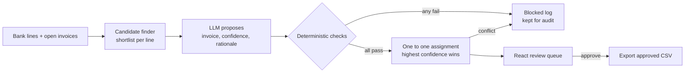

# ReconPilot

LLM assisted payment reconciliation where the model proposes, deterministic checks verify, and a human approves.

Finance teams spend hours matching incoming bank payments to open invoices. Simple rules catch the clean cases but miss anything messy: a reformatted reference, a payer name that differs from the customer record, a bank fee taken off the amount. An LLM is good at reading that mess, but it will also confidently match a part payment to the full invoice or pick an invoice id that does not exist. ReconPilot uses the model for what it is good at and never lets it touch the money on its own.



## What the checks enforce

Every proposal, from the LLM or the rules baseline, goes through the same gate in [`Verifier.kt`](core/src/main/kotlin/dev/vaibenz/reconpilot/verify/Verifier.kt). A single failure blocks it.

| Check | Rule |
|---|---|
| Currency | Bank line and invoice currency must be identical |
| Amount | No overpayment beyond 0.01, and any shortfall must fit a bank fee allowance of 2% of the invoice, capped at 50.00 |
| Date | Paid on or after the issue date and no later than 60 days past due |
| Reference | If the description cites an invoice number, it must be this invoice |
| Counterparty | Without a matching reference, the payer name must share a token with the customer name once legal suffixes are stripped |

The model also cannot invent invoices: a proposal that names an id outside the ledger is rejected as `UNKNOWN_ID`, and when two bank lines claim the same invoice only the more confident one survives.

## Evaluation

[`DatasetGenerator`](core/src/main/kotlin/dev/vaibenz/reconpilot/eval/DatasetGenerator.kt) builds a seeded, labelled dataset (172 bank lines, 212 open invoices, 131 true matches) covering ten scenarios: clean payments, reformatted references, number only references, fee deductions, name only transfers, truncated references, look alike twin invoices, part payments, wrong currency and unrelated credits. The files live in [`data/`](data).

[`EvalMain`](core/src/main/kotlin/dev/vaibenz/reconpilot/eval/EvalMain.kt) scores three pipelines on precision and recall:

1. **Rules only**: exact reference and exact amount, the baseline most teams start with
2. **LLM proposals, unverified**: what the model would do on its own
3. **LLM proposals + deterministic checks**: the ReconPilot pipeline

It writes [`eval/report.md`](eval/report.md) with an overall table and a per scenario breakdown, plus `eval/llm_rejections.jsonl`, which logs every AI suggestion the verifier blocked with each check result and a verdict of whether the verifier caught a genuinely wrong match or was too strict on a correct one.

Model replies are cached in `eval/llm_cache.jsonl` keyed by a hash of the prompt, so a run is reproducible and free to repeat once the cache exists.

Results on the committed dataset with Gemini 3.5 Flash-Lite (replies cached in `eval/llm_cache.jsonl`, so `./gradlew :core:eval` reproduces these numbers without a key):

| Pipeline | Matches made | Correct | Wrong | Precision | Recall | F1 |
|---|---|---|---|---|---|---|
| Rules only (exact reference and amount) | 60 | 60 | 0 | 1.000 | 0.458 | 0.628 |
| LLM proposals, unverified | 131 | 120 | 11 | 0.916 | 0.916 | 0.916 |
| LLM proposals + deterministic checks | 120 | 119 | 1 | 0.992 | 0.908 | 0.948 |

What the numbers say:

1. **The LLM doubles recall.** Rules find none of the fee deductions, name only transfers or number only references; the model gets all 55 of them.
2. **On its own, the LLM is not safe to trust.** It matched all 10 part payments to the full invoice. The amount check blocked every one, lifting precision from 0.916 to 0.992 for a single lost correct match.
3. **Confidence is not calibrated.** The one wrong match that survived is a look alike twin invoice: same customer, same amount, no reference. Both invoices pass every check, so the verifier cannot tell them apart, and the model picked the wrong one at 0.95 confidence despite being told to abstain when two invoices are equally plausible. That is the reason a human approves every match rather than auto posting high confidence ones.

Run it against a live model with your own key:

```bash
# Free: Gemini API key from Google AI Studio, throttled to stay inside free tier limits
GEMINI_API_KEY=... ./gradlew :core:eval

# Or Anthropic
ANTHROPIC_API_KEY=... ./gradlew :core:eval
```

On the free tier the run is paced at 12 requests a minute, so it takes about 15 minutes. Replies are cached as they arrive, so stopping and rerunning picks up where it left off. Delete `eval/llm_cache.jsonl` to force fresh calls.

### Known trade off

The reference check is deliberately strict. A truncated reference such as `INV-4821` for invoice `INV-48217` reads as a citation of a different invoice, so the verifier blocks it even when the model guessed right. In the run above that cost exactly one correct match. Interestingly the model was cautious here too, abstaining on 7 of the 8 truncated references. I chose to give up that recall rather than let a mismatched reference through, and the rejection log makes the cost visible.

## Running it

Requirements: JDK 21 and Node 22.

```bash
# API on :8080, loads data/ on start. Uses an LLM if ANTHROPIC_API_KEY or GEMINI_API_KEY is set, rules otherwise.
./gradlew :server:run

# Review UI on :5173, proxies /api to the server
cd web && npm install && npm run dev
```

For a single process, run `npm run build` in `web/` first and the server will serve the built UI from `web/dist`.

Optional environment variables:

| Variable | Default | Purpose |
|---|---|---|
| `RECONPILOT_MODEL` | `claude-haiku-5-5` | Anthropic model |
| `RECONPILOT_GEMINI_MODEL` | `gemini-3.5-flash-lite` | Gemini model |
| `RECONPILOT_RPM` | `12` | Gemini requests per minute |
| `RECONPILOT_DATA`, `RECONPILOT_WEB`, `PORT` | `data`, `web/dist`, `8080` | Server paths and port |

### API

| Method | Path | Purpose |
|---|---|---|
| GET | `/api/summary` | Counts for the current run |
| GET | `/api/queue` | Proposals that passed every check, with review status |
| GET | `/api/blocked` | Proposals the checks or conflict resolution rejected |
| GET | `/api/unmatched` | Bank lines with no accepted proposal |
| POST | `/api/proposals/{bankLineId}/{approve,reject,reset}` | Record a review decision |
| POST | `/api/reconcile` | Rerun on new CSVs: `{"bankLinesCsv": "...", "invoicesCsv": "..."}` |
| GET | `/api/export` | Approved matches as CSV |

## Project layout

```
core/     Kotlin domain: models, CSV, candidate finder, rules and LLM matchers, verifier, reconciler, eval
server/   Ktor API around the core with an in memory review store
web/      React + TypeScript review queue built with Vite
data/     Seeded labelled dataset
eval/     Evaluation report, LLM cache and rejection log
```

## Tests

```bash
./gradlew test
```

Unit tests cover every check, the reconciler with a scripted fake model (fee deductions, part payments, hallucinated ids, conflicts, messy JSON replies), CSV parsing and dataset determinism. Server tests drive the API through Ktor's test host. CI runs the tests, the baseline evaluation, and the web lint and build on every push.

## License

MIT
